# 4-Person Work Allocation & Engineering Plan

To execute this build plan rapidly and without overlap, work is divided across **4 specialized engineering tracks**. Each team member owns specific agents, integration layers, and test suites.

---

## 1. Individual Track Distribution

### Developer Track 1: Core Orchestration & Supervisor Engine
* **Supervisor uAgent Architecture**: Build central Supervisor process and Chat Protocol binding.
* **ASI:One Planner API Integration**: Connect to `/v1/chat/completions` with `planner_mode: true` and `stream: true`.
* **Streaming SSE Parser**: Process streaming `plan_state` updates and generate progress narratives.
* **Human-in-the-Loop (HITL) State Machine**: Manage tool call pauses (`finish_reason == "tool_calls"`) and session continuity (`x-session-id`).

### Developer Track 2: Data Engine & Healthcare Analytics
* **Agent 1 (EHR Search)**: Build multi-filter record lookup agent querying demographics, room numbers, conditions, and clinicians.
* **Agent 2 (Math & Analytics)**: Build Pandas-backed deterministic calculation engine for exact averages, percentages, and hospital group-by comparisons.
* **Dataset Loader**: Ingest `Sample_Dataset.csv` (76 fields) into memory and SQLite.
* **Validation**: Test evaluation questions in Categories A, B, C, D, E, F, G, H, I from `Questions - User.pdf`.

### Developer Track 3: Clinical Triage & Document Generation
* **Agent 3 (Clinical Triage)**: Evaluate `acuity_score`, `human_review_required`, and trigger Level 2 emergency escalations (`L2`, `on_call_clinician`).
* **Agent 4 (Doc Generator)**: Build programmatic PDF document compiler using `fpdf2`.
* **PDF Layout Templates**: Design Discharge Summaries, Itemized Accounting Invoices, and 30+ Day Administrative Case Reviews.
* **Validation**: Test Category J advanced multi-agent tasks (Questions 95, 98, 100).

### Developer Track 4: External Integrations, Agentverse & Presentation
* **Agent 5 (Workspace Sync)**: Google Workspace API integration (Gmail outreach, Google Calendar review slots, Google Sheets live sync).
* **Agent 6 (Compliance & Audit)**: Verify patient consent (`email_consent`, `sms_consent`) and log HIPAA audit event records.
* **Agentverse Cloud Hosting**: Deploy all 7 agents on `agentverse.ai`, publish Chat Protocol manifests (`publish_manifest=True`), and register `agent1q...` addresses.
* **Hackathon Deliverables**: Assemble pitch deck, write presentation script, and record backup execution video.

---

## 2. Granular Task Checklist per Team Member

### **Developer 1**
- [ ] Implement `supervisor_agent.py` using `uagents` and `uagents_core.contrib.protocols.chat`.
- [ ] Connect Supervisor to ASI:One Chat Completions API endpoint with `planner_mode: true`.
- [ ] Build streaming parser to convert raw `plan_state` updates into plain-English progress sentences.
- [ ] Implement `tools` parameter definition for tool hand-backs when `finish_reason == "tool_calls"`.
- [ ] Maintain `x-session-id` state across approval turns.

### **Developer 2**
- [ ] Create `dataset_loader.py` to index `Sample_Dataset.csv` (76 columns) using Pandas and SQLite.
- [ ] Implement `agent_1_ehr_search.py` to handle single-patient and multi-criteria queries.
- [ ] Implement `agent_2_math_analytics.py` using Pandas to compute exact length-of-stay averages, abnormal test percentages, and billing totals.
- [ ] Verify answers against Category A–I questions in `Questions - User.pdf`.

### **Developer 3**
- [ ] Implement `agent_3_clinical_triage.py` for risk evaluation, abnormal lab triage, and `L2` emergency escalations.
- [ ] Build `utils/pdf_builder.py` using `fpdf2` for dynamic PDF generation.
- [ ] Implement `agent_4_doc_generator.py` to generate PDF Discharge Summaries, Accounting Invoices, and Case Reviews.
- [ ] Test multi-agent document generation workflows for Category J questions.

### **Developer 4**
- [ ] Setup Google Cloud Service Account and configure OAuth 2.0 scopes (`gmail.send`, `calendar.events`, `spreadsheets`, `drive.file`).
- [ ] Implement `agent_5_workspace_sync.py` for Gmail sending, Google Calendar event creation, and Google Sheets sync via `gspread`.
- [ ] Implement `agent_6_compliance_audit.py` to verify patient consent flags (`email_consent`, `sms_consent`) and log HIPAA audit events (`audit_event_type`).
- [ ] Host all 7 agents on Agentverse (`agentverse.ai`), publish manifests (`publish_manifest=True`), and capture `agent1q...` addresses.
- [ ] Prepare pitch deck slides and record backup demo execution video.

---

## 3. Timeline & Dependency Chart

```mermaid
gantt
    title Healthcare Agent Orchestration Build Timeline
    dateFormat  HH:mm
    axisFormat %H:%M

    section Phase 0 & Setup
    Env Setup & API Keys          :a1, 00:00, 1h
    Dataset & Schema Ingestion    :a2, 00:00, 1h

    section Agent Development
    Supervisor & Planner Stream   :b1, after a1, 2h
    EHR Search & Math Agents      :b2, after a2, 2h
    Triage & PDF Doc Gen Agents   :b3, after a2, 2h
    Workspace & Compliance Agents :b4, after a1, 2h

    section Integration & Deployment
    System Wiring & HITL Hand-Back:c1, after b1, 2h
    Agentverse Hosting & Address Sync:c2, after b4, 1h

    section Testing & Pitch
    Category A-J Question Audits  :d1, after c1, 1.5h
    Pitch Deck & Backup Video     :d2, after c2, 1.5h
```

