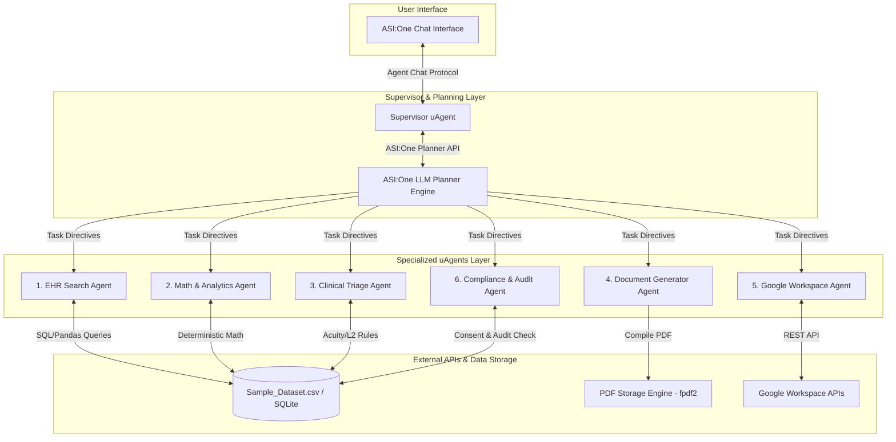

# Complete Tech Stack & System Architecture Document

## 1. Stack Layer Breakdown

The **Healthcare Agent Orchestration System** combines a decentralized agent runtime, LLM-based multi-agent planning, deterministic data handling, programmatic document compilation, and Google Workspace integrations.

### Components:
1. **User Interface**: ASI:One Native Chat Interface (`asi1.ai/chat`).
2. **Orchestration Layer**: Supervisor uAgent communicating with the ASI:One Chat Completions API with `planner_mode: true`.
3. **Specialized Agent Layer**: 6 domain-specific uAgents built with Python `uagents` framework.
4. **Data & External Integrations Layer**: Pandas/SQLite over `Sample_Dataset.csv`, `fpdf2` for PDFs, and Google Workspace APIs (Gmail, Google Calendar, Google Sheets).

---

## 2. Technology Matrix

| Stack Component | Chosen Technology | Version / Requirement | Purpose |
| :--- | :--- | :--- | :--- |
| **Language** | Python | `3.10+` | Core agent logic, data manipulation, and API scripting. |
| **Agent Framework** | `uagents` | `>= 0.12.0` | Autonomous agent runtime, protocol binding, and address generation. |
| **Protocol** | `uagents-core` | `contrib.protocols.chat` | Agent Chat Protocol standard for ASI:One compatibility. |
| **LLM Orchestration** | ASI:One Planner | `/v1/chat/completions` | Multi-step task decomposition and specialist routing. |
| **Cloud Platform** | Fetch.ai Agentverse | `agentverse.ai` | Agent hosting, manifest publishing, and discovery. |
| **Data Engine** | Pandas & SQLite3 | `pandas >= 2.0.0` | Exact, deterministic healthcare calculations. |
| **PDF Generation** | `fpdf2` | `>= 2.7.0` | Programmatic PDF report and invoice compilation. |
| **Google Integration** | Google Cloud APIs | `gspread`, `google-api-python-client` | Gmail, Calendar, Sheets integration. |

---

## 3. Architectural System Diagram

