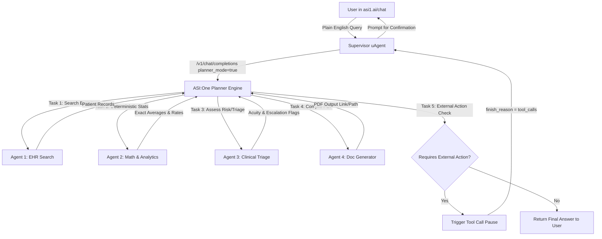
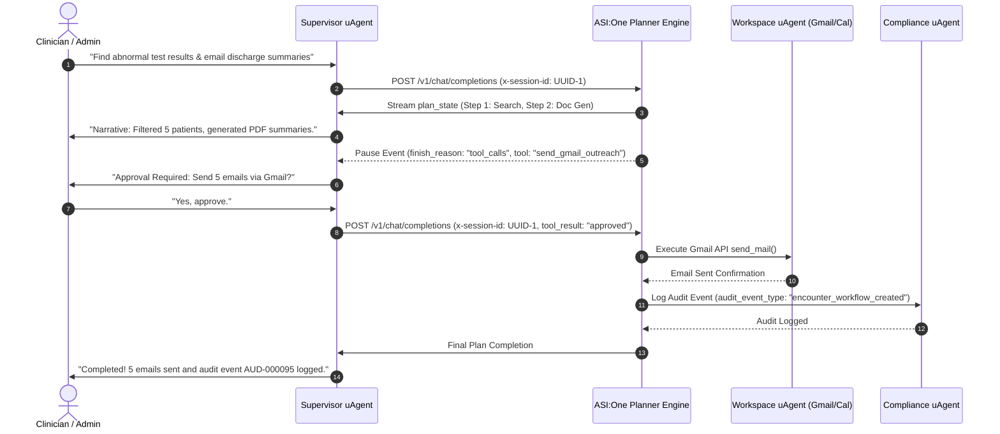

# Complete User Flow Document — Healthcare Agent Orchestration System

## 1. Executive Overview & Target Personas
The **Healthcare Agent Orchestration System** operates as a natural-language-driven operations platform built on the **ASI:One + Agentverse framework**. Clinicians and hospital administrators interact directly with a central **Supervisor Agent** inside the native **ASI:One Chat Interface (`asi1.ai/chat`)**. The system interprets plain-English requests, dynamically plans multi-agent tasks, executes data lookups, performs deterministic healthcare statistics, generates PDF reports/invoices, updates Google Workspace tools (Gmail, Calendar, Sheets), and enforces Human-in-the-Loop (HITL) safety controls.

### Target Personas:
1. **Attending Clinicians & Triage Nurses**: Request patient lifecycle histories, abnormal lab triage reports, and post-discharge follow-up scheduling.
2. **Hospital Administrators & Department Heads**: Query hospital utilization, average length of stay (LOS), admission volume trends, and 30+ day case reviews.
3. **Billing Officers & Financial Analysts**: Generate itemized accounting invoices, evaluate insurance payor coverage, and identify billing anomalies.
4. **Compliance & Audit Officers**: Verify patient communication consent (`sms_consent`, `email_consent`), trace emergency escalations (`L2`), and review HIPAA event logs.

---

## 2. End-to-End Operational User Journey

### Phase A: Request Submission & Supervisor Intent Capture
* **User Action**: The user opens `asi1.ai/chat`, @mentions the **Supervisor Agent**, and types a plain-English request.
* **Supervisor Action**: Receives the text via the **Agent Chat Protocol** (`uagents_core.contrib.protocols.chat`).
* **Planner Invocation**: Supervisor calls the ASI:One API (`/v1/chat/completions`) with `planner_mode: true`, passing a fresh `x-session-id` UUID header and an explicit list of specialist Agentverse addresses (`agents: ["agent1q..."]`).

### Phase B: Dynamic Multi-Agent Plan Generation & Progress Narration
* **ASI:One Planner**: Decomposes the query into sequential sub-tasks mapped to specialist capabilities.
* **Supervisor Streaming Feedback**: As `plan_state` updates stream back from ASI:One, the Supervisor translates raw state objects into plain-English progress messages (e.g., *"Step 1/4: Querying EHR database for patients with abnormal test results..."*).

### Phase C: Specialized Task Execution
1. **EHR Data Retrieval**: Agent 1 queries `Sample_Dataset.csv` across 76 fields (e.g., `patient_id`, `primary_condition`, `admission_date`).
2. **Statistical Math Calculations**: Agent 2 runs deterministic `pandas` logic to calculate averages, percentages, and group totals.
3. **Clinical Risk Triage**: Agent 3 assesses `acuity_score`, `human_review_required`, and `escalation_level`.
4. **Document Generation**: Agent 4 programmatically compiles print-ready PDFs (Discharge Summaries, Invoices, Administrative Case Reviews).
5. **Google Workspace Sync**: Agent 5 updates Google Sheets queues and prepares Google Calendar events or Gmail outreach drafts.

### Phase D: Human-in-the-Loop (HITL) Approval Pause
* **Trigger**: Any external or irreversible action (sending Gmail emails, booking calendar slots, issuing financial charges) triggers a pre-defined tool call in ASI:One.
* **System Pause**: ASI:One halts plan execution and returns `finish_reason: "tool_calls"`.
* **User Confirmation Request**: The Supervisor asks the user in chat: *"I have generated the discharge summary and prepared follow-up emails for 3 patients. Do you approve sending these via Gmail?"*

### Phase E: Final Execution & Compliance Audit
* **User Resume**: User replies "Yes" or "Approved".
* **Plan Continuation**: Supervisor resubmits the tool confirmation to ASI:One using the same `x-session-id`.
* **Outreach Dispatch**: Agent 5 executes the Gmail API call.
* **Audit Logging**: Agent 6 appends a HIPAA compliance record (`audit_event_type: "encounter_workflow_created"`) and returns the final completion summary.

---

## 3. Visual System Flowcharts

### Diagram 1: High-Level Query Orchestration Flow

### Diagram 2: Human-in-the-Loop (HITL) Sequence Diagram

---

## 4. Query Categories & Sample Interaction Triggers

The system fully satisfies all 100 evaluation questions across Categories A through J:

| Category | Example User Query | Primary Specialist Agents | Expected Output |
| :--- | :--- | :--- | :--- |
| **A. Patient ID & Basics** | *"Show all available information for Bobby Jackson."* | Agent 1 (EHR Search) | Complete record details (`PAT-000001`, Age 19, Blood AB+, Clinician-002). |
| **B. Lifecycle & History** | *"What was Bobby Jackson's total bill and length of stay?"* | Agent 1 (EHR Search), Agent 2 (Analytics) | Journey timeline (Admitted 31-01-2024, Stay: 7 days, Bill: \$2,212.27). |
| **C. Hospital & Doctor** | *"List all patient records assigned to room 328 at Northwestern Memorial."* | Agent 1 (EHR Search) | Room roster table matching facility & room. |
| **D. Admissions & Discharges**| *"What was the average hospital stay for emergency admissions?"* | Agent 2 (Math & Analytics) | Deterministic Pandas average LOS (e.g. 18.4 days). |
| **E. Conditions & Meds** | *"Compare average length of stay between cancer and heart disease."* | Agent 2 (Math & Analytics) | Side-by-side Pandas statistical breakdown. |
| **F. Test Results** | *"What proportion of all test results were abnormal?"* | Agent 2 (Math & Analytics) | Exact percentage calculation (e.g. 42.8%). |
| **G. Billing & Insurance** | *"Show top ten admissions with highest billing amounts."* | Agent 1 (EHR Search), Agent 2 (Analytics) | Sorted top 10 patient billing list. |
| **H. Operational Analytics**| *"Which hospital handled the highest number of admissions?"* | Agent 2 (Math & Analytics) | Facility group-by volume metrics. |
| **I. Multi-Filter Queries** | *"Show female patients over 60 with diabetes and stays > 10 days."* | Agent 1 (EHR Search) | Filtered multi-criteria dataset table. |
| **J. Advanced Multi-Agent** | *"Identify stays > 30 days with abnormal tests, generate PDF review, sync to Google Sheets, and draft emails."* | Agents 1, 2, 3, 4, 5, 6 | Multi-agent execution, PDF generated, Sheets synced, HITL pause, Gmail sent, HIPAA audit logged. |

---

## 5. Edge Cases & Exception Handling Rules
1. **Consent Verification Failure**: If Agent 6 detects `email_consent == FALSE` or `contact_allowed == FALSE` for a patient, Agent 5 blocks email dispatch and reports `communication_status: "blocked_by_consent"`.
2. **Guardian Consent Required**: For minor patients (`guardian_required == TRUE` or age < 18), outreach is flagged for legal guardian review before proceeding.
3. **Emergency L2 Escalation**: If `acuity_score == 5` and `escalation_required == TRUE`, Agent 3 automatically triggers an alert to the `on_call_clinician` role.
4. **Network / Timeout Disruption**: If a specialist agent fails to respond during a multi-step plan, ASI:One's planner re-evaluates the step or returns a structured error to the Supervisor, which gracefully notifies the user without crashing.
